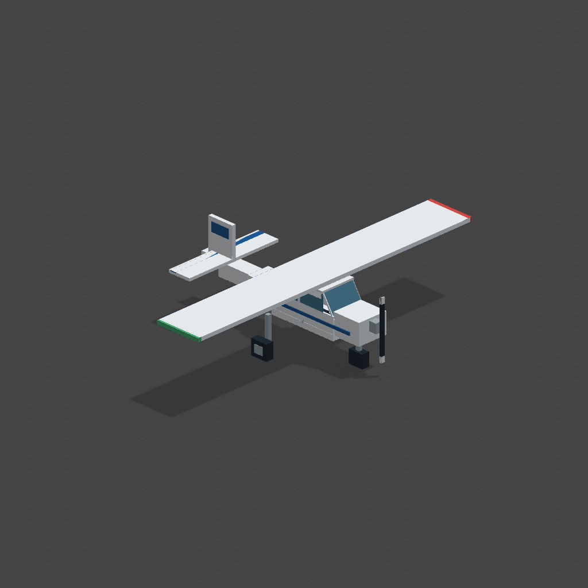
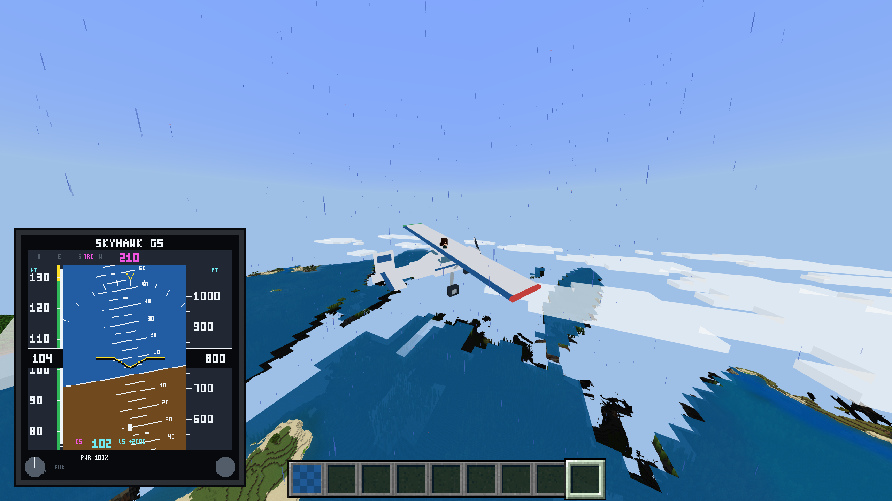

# Cessna 172S for Minecraft Bedrock

A flyable Cessna 172S Skyhawk add-on with keyboard flight controls, a readable G5 screen overlay, mouse orbit, and an in-game Flight Toolkit. Current release: **v2.8.5**.

**[Download the all-in-one add-on](https://github.com/lokeuei/cessna172s-bedrock/releases/latest)** · [Report an issue](https://github.com/lokeuei/cessna172s-bedrock/issues)



*Aircraft model preview from development.*

## What's included

- Cessna aircraft with a seated pilot, animated flight attitude, landing gear, engine and wind sounds, and white/blue livery with colored wing tips.
- Flight simulation with throttle, elevator, roll, rudder, lift, drag, gravity, stalls, and ground braking.
- Mouse orbit that stays where you look while the seated pilot follows the aircraft's attitude.
- G5 screen overlay showing indicated airspeed, altitude, artificial horizon, heading, compass direction, ground track, ground speed, vertical speed, and power.
- Flight Toolkit menu: spawn an aircraft, build a runway, reset an aircraft, save its home position, recover controls, and toggle the G5.
- Automatic toolkit delivery on a player's first join, with retries when their inventory is full; a Creative aircraft spawn egg is also included.
- Both behavior and resource packs, bundled together with matching dependencies.



*Earlier development gameplay screenshot showing the G5 in flight. This predates the v2.8.5 pilot attachment and orbit fixes; it is not a screenshot of the final release.*

## Install and share

1. Use **Minecraft Bedrock 1.26.60 or newer**. This add-on is not for Java Edition.
2. Download `Cessna172S-V2.8.5-ALL-IN-ONE.mcaddon` from [Releases](https://github.com/lokeuei/cessna172s-bedrock/releases/latest) and open it with Minecraft.
3. In your world's settings, activate **both** matching Cessna behavior and resource packs. Deactivate older Cessna versions in that world.
4. Enable cheats for the command-based airport and recovery functions. Enter the world and use the Flight Toolkit.

Minecraft supplies the `@minecraft/server` and `@minecraft/server-ui` modules. No other downloaded add-on is required. If Minecraft shows stale UI or old behavior after upgrading, fully close and reopen the game.

To share the add-on, send the single `.mcaddon` file or the release link. Each recipient imports it and enables both packs in their own world.

## Flying

Spawn a Cessna using the toolkit or the Creative spawn egg, then interact with it to board. Use a clear area with room for the wings and runway.

| Input | Action |
| --- | --- |
| W / S | Nose down / nose up |
| A / D | Roll left / right |
| Space + A / D | Rudder left / right |
| Hotbar slots 1–9 | Select throttle setting |
| Slot 1 | Idle; ground brakes |
| Mouse | Orbit the camera independently |
| Shift | Exit the aircraft |

Park the aircraft and choose **Set home** before using **Reset aircraft**. Reset uses the aircraft's saved airport start. Toolkit actions use your ridden aircraft or the nearest Cessna within 16 blocks, and reject an aircraft occupied by another pilot.

**Build runway** creates a 640 × 25 elevated runway and changes the world. The menu asks for confirmation; blocked construction can leave completed sections behind. Use a test world or a backup when trying it.

## G5 and performance

The G5 remains a screen overlay so it is readable outside the small cockpit. Airspeed and altitude tapes scroll fixed textures. Horizon pitch scrolls a cached image, while bank selects from 36 cached images at 10-degree intervals. It does not continuously rotate a single texture.

The display uses **20 instrument controls**, reduced from the earlier 596-control implementation. Telemetry refreshes at up to 5 Hz, with a two-second keepalive for unchanged values; flight physics runs at 20 Hz. The toolkit's G5 toggle lets you compare performance in your world. No frame-rate improvement percentage has been measured.

## Updating and troubleshooting

- **Missing dependencies:** import the all-in-one file and activate its matching behavior/resource pair. Remove older active Cessna versions before testing.
- **Blank G5 or old version text:** check that the current resource pack is active and restart Minecraft to clear cached resources. Check the Content Log if it persists.
- **Camera or movement stuck:** use **Recover controls** in the toolkit. Normal dismount also restores camera and movement permissions.
- **Remove old available packs:** deactivate them in worlds and Global Resources, then open **Settings → Storage → Resource Packs / Behavior Packs**, select the old entry, and delete it. Back up worlds that depend on those packs first.
- **Custom skins or other add-ons:** the pilot pose and player behavior override can conflict with other player modifications. Custom skeletons need separate testing.

This is a game add-on with simplified flight and instrument behavior, not a real-world flight trainer. Minecraft, Cessna, and Garmin names refer to their respective owners; this is an unofficial project.

## Source and development

| Path | Contents |
| --- | --- |
| `cessna172s/behavior_packs/skyhawk` | Flight scripts, entities, toolkit, camera preset, functions |
| `cessna172s/resource_packs/skyhawk` | Aircraft geometry, textures, animations, G5 UI, audio |
| `check-*.mjs` | Flight, telemetry, toolkit, and airport regression checks |
| `generate-g5-assets.mjs` | Cached G5 texture generator |
| `generate-plane-sounds.mjs` | Procedural aircraft audio generator |
| `scripts/package.ps1` | Builds the two packs and the combined `.mcaddon` |

Use Node.js 22+ and PowerShell 7+:

```powershell
npm ci
npm test
npm run package
```

The authored pack files are the source of truth. Packaging does not regenerate or replace the verified UI, geometry, or pilot animations. Optional asset regeneration: `npm run assets:g5` and `npm run assets:audio`.

v2.8.5 was checked in-game with the full G5 and two aircraft present; horizontal and vertical mouse orbit were confirmed after removing the rider yaw clamp. Automated checks cover 24 flight/camera/control scenarios and 420 telemetry/crop cases, plus toolkit delivery and airport reset. These checks do not replace in-game rendering and multiplayer testing.

## v2.8.5 changes

- Restored mouse orbit without per-tick camera resets or a horizontal rider rotation clamp.
- Kept the pilot aligned with the aircraft through the seated animation and hip compensation.
- Bundled the working G5 overlay, toolkit, Creative spawn egg, and both dependency-matched packs in one download.
